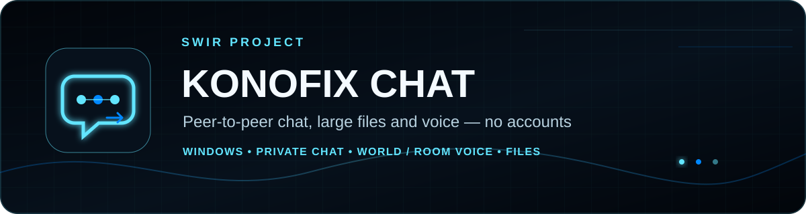
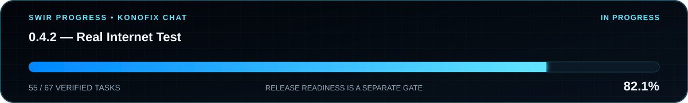

<!-- SWIR-README-STANDARD:v2 -->

<div align="center">



<br>

**Peer-to-peer text, voice and file sharing for Windows**

**No traditional accounts • WORLD and private chat • Participant-created network • Optional headless Node**


[](https://github.com/Swir/Konofix/actions/workflows/windows-ci.yml)
[](https://github.com/Swir/Konofix/actions/workflows/linux-node-ci.yml)
[](https://github.com/Swir/Konofix/stargazers)
[](https://github.com/Swir/Konofix/releases/latest)

[**Download**](https://github.com/Swir/Konofix/releases/latest) · [**User guide**](docs/USER_GUIDE.md) · [**Highlights**](#highlights) · [**Quick Start**](#quick-start) · [**Architecture**](#architecture) · [**Roadmap**](#roadmap)

</div>


## Project status

**Konofix Chat 0.6.0 — stable chat feature release.** See [GitHub Releases](https://github.com/Swir/Konofix/releases) for published installers, checksums and release-specific acceptance notes. Use the same version on both computers.

### Stable chat feature scope

**Stable chat feature implementation: 100% (10/10 defined feature groups).** The ten shipped groups are listed below. This is a bounded inventory of implemented application features, **not** a claim that every feature, file size, router, country or network topology has been physically tested, or that the entire roadmap is finished. The built-in updater client is implemented; the signed update publishing service is not configured, so this release uses manual installation.

The user confirmed that the latest audio-fix candidate plays private voice on both PCs and no longer produces the reported error after hangup. That acceptance does not identify the network route or qualify unrelated load, failover or maximum-size scenarios. See the [acceptance record](docs/evidence/CHAT_AUDIO_ACCEPTANCE_20261013.md) and [0.6.0 release notes](docs/RELEASE_0.6.0.md) for the distinction between CI and user acceptance.

### Separate network qualification



**Verified checklist fraction: 56 of 67 tasks — 83.6%.** This is the separate network-qualification checklist, not the feature implementation inventory.

**Real Internet Test milestone: 83.6% complete**

The authoritative Real Internet Test / Global Beta readiness scope has **56 of 67 tasks complete**. The progress graphic and this fraction come from [`ROADMAP.md`](ROADMAP.md), not from the ten-feature inventory. The remaining public-network, capacity, soak and failover evidence gates stay open. Publishing a stable chat release does not complete them.

## What is Konofix?

Konofix Chat is a Windows messenger built with Tauri and Rust. Start it, choose a nickname and enter **#WORLD**. You can chat publicly or privately, create temporary rooms, share files, make a private audio call, take a timed WORLD speaking turn or join voice in a public room.

Every connected application is a participant in the native P2P network. You do not need to create an account, provide an email/phone number or rent a Konofix-owned VPS. **This does not mean the app uses no external servers:** Internet discovery/text fallback uses public third-party infrastructure, and WebRTC uses public STUN. Their availability and your NAT/firewall affect connectivity. See [how connections work](#architecture) and [the privacy boundaries](#security-and-trust-boundaries).

## Highlights

The following ten groups define the stable chat **implementation** scope:

| Shipped group | What is included | Important boundary |
|---|---|---|
| 1. Nickname and chat interface | Account-free entry, nickname colors, emoji picker and safe text rendering. | A nickname is not verified real-world identity. |
| 2. WORLD text and discovery | Public global room, online presence, LAN mDNS, native peer discovery and signed multi-relay Internet fallback. | Public infrastructure is needed for the fallback; no universal connectivity guarantee. |
| 3. Temporary rooms | Create/join public rooms, owner-managed rooms, membership counts and native password-protected rooms. | Protected rooms are not announced over the public fallback. |
| 4. Private text | Authenticated native direct messages, NIP-44 encrypted relay private messages, notifications and incoming-chat controls. | Recipients must be online; public WORLD is not private. |
| 5. File sharing | WORLD/room offer cards, private recipient approval, native/WebRTC streaming up to 32 GiB, progress, cancellation and SHA-256 verification. | 32 GiB is a supported size limit, not a promise of successful delivery over every network. Legacy encrypted relay files remain limited to 2 MiB. |
| 6. Image preview | One file-sharing action automatically recognizes PNG/JPEG/GIF/WebP and offers an explicit preview. | Preview limit is 8 MiB; larger images remain ordinary downloadable files. |
| 7. Private audio | Accept/reject, outgoing/incoming ringing, microphone mute and hangup; encrypted WebRTC media. | Requires the public WORLD signaling identity and a working WebRTC route. |
| 8. WORLD and room voice | WORLD queue with one 60-second speaker and early finish; simultaneous voice in public user-created rooms. | Protected-room voice is not available. Group media is peer-to-peer, not a hosted conference service. |
| 9. Audio controls and languages | WORLD-only speaker mute, microphone/speaker tests; English, Polish, Norwegian, German, French, Spanish and Ukrainian UI. | App language is selected at startup from system/browser preferences, with English fallback. |
| 10. Stable-update client | Startup/manual check, stable-version filtering, user confirmation and signed-update verification. | Signed publishing is not configured for this release; install manually from GitHub. |

Optional operator tools and KonoNexus contacts are described separately below; they do not enlarge this ten-group completion claim.

## Quick Start

1. Download the **0.6.0 Windows installer** and its checksum from [GitHub Releases](https://github.com/Swir/Konofix/releases/latest). Do not download only the source-code ZIP. Install the same release on both PCs.
2. Close an older Konofix instance, run the `setup.exe`, then open **Konofix Chat** from the Start menu. The MSI is an alternative installer when included. Node and Netprobe are command-line tools, not the chat window.
3. Choose a nickname/color. Keep **public WORLD discovery** selected for Internet discovery and text fallback, then join WORLD. Devices on a suitable LAN also discover each other through mDNS.
4. Type in WORLD, or select a participant's private-chat action. Use the attachment button for a direct file offer or the room's **Share file** button for an on-demand public offer.
5. For audio, permit microphone access in Windows, then use the private call button, WORLD speaking queue or public-room voice button. **Network settings** contains microphone/speaker tests and **Mute WORLD voice**.

Read the [complete user guide](docs/USER_GUIDE.md) for rooms, queues, downloads, settings, privacy and troubleshooting. Builds are not Microsoft Authenticode-signed; a checksum verifies the downloaded bytes but is not a code-signing certificate. Do not disable Windows security or your firewall to make the app work.

### From source

Requirements: Windows 11, Node.js 22+, Rust with the MSVC target and the Tauri 2 Windows build prerequisites, including WebView2.

```powershell
git clone https://github.com/Swir/Konofix.git
cd Konofix
npm ci
npm run tauri dev
```

Validate with `npm run audit`, `npm run build` and the Rust checks in `scripts/check.ps1`. Build the Windows application using `scripts/build-windows.ps1`; the default bundle path is `src-tauri\target\release\bundle`.

## Architecture

Konofix has complementary network paths, not one central chat server:

| Path | How it works | Data carried |
|---|---|---|
| Native P2P | `rust-libp2p`: TCP/QUIC, Noise/Yamux, GossipSub, Kademlia, mDNS, Identify/Ping; AutoNAT, UPnP, DCUtR and participant circuit relays where available. | Native presence, public rooms/text, authenticated private control and streamed files. |
| Public discovery | Amino DHT contact hints followed by validation of short-lived signed advertisements; bounded peer caching/reconnects. | Untrusted discovery hints, not a central identity authority or file store. |
| WORLD fallback | Several third-party WSS Nostr relays; signed, expiring events, duplicate suppression and bounded reconnect queues. | Public WORLD/room content, presence, file-offer metadata and queue state; encrypted private text, small-file fallback and WebRTC setup. |
| WebRTC | Encrypted peer-to-peer audio and data channels; STUN at Cloudflare/Google helps discover candidate addresses. | Audio and large-file bytes, not uploaded to WORLD text relays. |

The configured WORLD relays are `relay.damus.io`, `nos.lol`, `relay.primal.net` and `nostr.mom`. They are independent third-party services with no Konofix availability guarantee. The native bootstrap pool is optional and empty; public IPFS bootstrap peers are not Konofix relays.

**No TURN fallback is currently configured.** The retired anonymous TURN service was removed. STUN is not a media relay, so restrictive symmetric NAT, CGNAT or firewall rules can prevent WebRTC audio/large files even while public and private text work. Native participant relays and WebRTC TURN are different mechanisms. Do not infer a successful media route from a visible online user.

Further details: [cold-start discovery](docs/COLD_START_DESKTOP.md), [WORLD relay protocol](docs/WORLD_RELAY_FALLBACK.md), [participant-network plan](docs/GLOBAL_BETA.md). Historical documents may describe older release limitations; this README and the [current user guide](docs/USER_GUIDE.md) describe 0.6.0.

## Security and trust boundaries

- WORLD and unprotected public rooms are public. Nostr operators can read/copy their text, room names, public-file metadata and WORLD speaking state. Signed events authenticate the sender's key, not the truth of their nickname or claims.
- Native traffic uses authenticated encrypted libp2p transport. Relay-only private text and legacy small files use recipient-addressed NIP-44 encryption. WebRTC setup is encrypted to the recipient; WebRTC encrypts media/data between endpoints.
- External services and network peers can observe IP addresses, identifiers, timing and traffic sizes. Marking an event ephemeral or expired does not force an operator to delete it. There is no anonymity or guaranteed deletion promise.
- Protected-room access remains on the authenticated native path. It is not silently moved to public relays; protected-room group voice is unavailable.
- Receiving a private file requires approval; public cards require an explicit download/preview. File size/hash checks, bounded transfer state and safe non-overwriting saves protect transfer integrity, not against malicious file contents. Do not execute unknown downloads.
- This is live messaging, not guaranteed offline delivery or a centrally backed-up message history. Keep both participants online for calls and transfers.
- Never publish identity files, signing keys, private contacts or unredacted diagnostic secrets. Report vulnerabilities through [`.github/SECURITY.md`](.github/SECURITY.md).

## Local data

| Data | Default location or lifetime |
|---|---|
| Received files | `Downloads\Konofix Chat` |
| Native peer-address cache | `%LOCALAPPDATA%\Konofix Chat\peer-cache.json` |
| Optional Node identity | `%LOCALAPPDATA%\Konofix Chat\node-identity.key`, unless `--identity-file` overrides it |
| UI preferences and relay identity | Application WebView local storage; includes a persistent relay signing identity, nickname color and mute/private-chat preferences |
| Image preview staging | Temporary `Konofix Chat\previews` directory; preview-only file is removed after a successful read |
| Optional KNP profile | `%LOCALAPPDATA%\Konofix Chat\KonoNexus\chat-profiles\<profile>`; persistent identity/routing state, with contacts/chat history in memory |

A nickname-only login does not mean no data is stored locally. Received files remain on disk until you remove them.

## Optional KonoNexus contacts

The KonoNexus/KNP panel is an additional direct contact-text channel. It does not replace WORLD, merge NodeIDs with libp2p PeerIDs or automatically resend across protocols. Participants must separately verify each other's NodeID and supply reachable UDP endpoints; automatic KNP WAN rendezvous/relay discovery is not implemented in this panel. See [the KNP guide](docs/KNP_CHAT_BETA.md). Ordinary WORLD use does not require it.

## Konofix Node

The optional headless Node is an always-on network participant for operators, not an account service, central chat history or cloud file store. Windows and isolated Linux builds, persistent identity, health telemetry, public-host checks and Netprobe are included in the repository.

Build the Windows Node with `build-node.bat`. The verified bundle provides `scripts/public-node.ps1` and `scripts/install-public-node-task.ps1` for controlled deployment. A public Node normally needs inbound **TCP 45555 and UDP 45555**. Configure only the intended application/port rules; do not disable the firewall. See [Node setup](docs/NODE.md), [Linux deployment](docs/NODE_LINUX.md) and [soak collection](docs/NODE_SOAK.md).

## CI and release integrity

Windows CI validates frontend behavior/localization/project policy, Rust formatting/Clippy/tests, locked dependency resolution, production application/Node/Netprobe builds, runtime smoke and the staged archive's contents and hashes. Linux Node CI checks the isolated headless build and authenticated TCP/QUIC runtime behavior. RustSec checks the locked dependency graph.

`BUILD_INFO.json`, installer/archive checksums and the generated tester handoff bind a full bundle to a particular build. Keep them together; do not mix different commits that share a version label. A green CI run is not evidence of two physical PCs, independent countries, CGNAT traversal or a successful 32 GiB transfer.

For formal qualification, use the [two-PC procedure](docs/TWO_PC_TEST.md), [testing guide](docs/TESTING.md), [client evidence guide](docs/CLIENT_NETPROBE_EVIDENCE.md) and `scripts/check-promotion-evidence.ps1`. The wider gate requires coherent TCP/QUIC/Relay/DCUtR/CGNAT observations, independent client evidence and exact-build Node-soak records. Do not fabricate or reuse unrelated evidence.

## Roadmap

[`ROADMAP.md`](ROADMAP.md) remains the authoritative qualification plan. The stable chat implementation inventory above is a separate product scope, not a replacement denominator.

The reviewed public-Node admission limits and Rooms 2.0 production membership/count wiring are verified. Public participant continuity, independent-network transport scenarios, 50/100/250-client capacity, multi-network/country soak, participant failover and the qualified Global Beta evidence package remain open where marked in the roadmap. Stable chat status does not promise those uncompleted scale/infrastructure outcomes.

## Releases

Download published packages at [GitHub Releases](https://github.com/Swir/Konofix/releases/latest). **0.6.0** brings the implemented chat, large-file and voice features together with the private-audio and shutdown fixes accepted by the user. Consult the [release notes](docs/RELEASE_0.6.0.md) for its exact source, checksums and scope; install the same version on all participants.

**Install updates manually for now.** The application contains a stable-only update client and asks permission before installing an authenticated update, but the signed updater publication prerequisites are not configured. Do not expect automatic upgrade until a valid signed updater package and `latest.json` are published. Updater signing is separate from Windows Authenticode signing.

`v0.5.3` is the earlier stable text/small-file release. The historical `v0.4.2-test1` prerelease and other old test packages are not current downloads and must not be mixed with current evidence tools. See [`CHANGELOG.md`](CHANGELOG.md) for changes and [the user guide](docs/USER_GUIDE.md) for troubleshooting.

## Project structure

```text
src/                  TypeScript desktop UI, WebRTC, relay fallback and localization
src-tauri/            Rust/Tauri application, native P2P and file handling
src-tauri/src/bin/    Optional Konofix Node and Netprobe binaries
scripts/              CI, release, progress and evidence tooling
node-linux/           Isolated headless Linux Node target
docs/                 User, operator, testing and security guides
.github/workflows/    Windows, Linux, security and release workflows
assets/readme/         SWIR hero and generated qualification-progress SVGs
```

## 🔎 Search Keywords

`peer to peer messenger` • `p2p chat windows` • `rust libp2p chat` • `tauri messenger` • `decentralized chat app` • `p2p file transfer windows` • `webrtc voice chat` • `private encrypted chat` • `world chat room` • `kademlia dht chat` • `nostr discovery fallback` • `rust tauri windows app` • `cross network p2p test` • `cg-nat p2p testing`


<div align="center">

### `CONNECT • VERIFY • RELEASE • EVOLVE`

⭐ **If Konofix is useful, consider leaving a star.**

[**← SWIR profile**](https://github.com/Swir) · [**All projects →**](https://github.com/Swir?tab=repositories)

</div>
